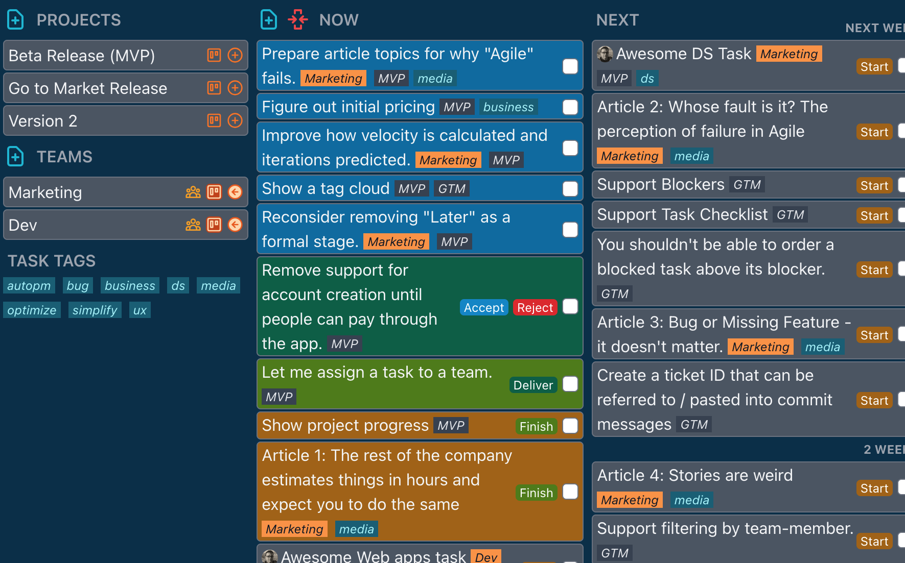

# Ok, Next!

**Get it done. One week at a time.**

Ok, Next! (`pm_tool`) is a lightweight project management app for individuals and small
teams. Instead of sprints and story points, work is organized into what you're doing
**now**, what's coming **next** week by week, what can wait until **later**, and what's
**done**.



## Features

- **Now / Next / Later / Done** boards, with upcoming work grouped by week
- **Projects** with their own task lists, which you can archive when finished
- **Teams** and team members, with tasks assigned to a team or a person
- **Tags** for filtering tasks across projects and teams
- **Estimates and velocity**, so you can see how much a team gets done each week
- **Milestones and due dates**
- **Blockers** and **comments** on tasks
- A **changelog** of everything that happened in a team or project
- Real-time updates, built with [Phoenix LiveView](https://github.com/phoenixframework/phoenix_live_view)
- Optional **Stripe billing** for running a hosted, paid instance

## Getting started

### Requirements

- Elixir 1.14 or later and Erlang/OTP (tested with Elixir 1.18 and OTP 27; see
  [`.tool-versions`](.tool-versions))
- A C compiler and `make` (for `bcrypt_elixir`)

The database is SQLite, so there's nothing else to install.

### Run it locally

```sh
mix setup         # install dependencies, create and migrate the database, build assets
mix phx.server    # or: iex -S mix phx.server
```

Then open [localhost:4000](http://localhost:4000) and register an account.

In development, emails (such as account confirmation and password reset) aren't sent.
You can read them at [localhost:4000/dev/mailbox](http://localhost:4000/dev/mailbox).

### Run the tests

```sh
mix test
```

## Deploying

Build assets and start the server in production mode:

```sh
export MIX_ENV=prod
mix deps.get --only prod
mix compile
mix assets.deploy
mix ecto.migrate
PHX_SERVER=true mix phx.server
```

See the [Phoenix deployment guides](https://hexdocs.pm/phoenix/deployment.html) for
other options, such as building a release.

### Configuration

Production is configured with environment variables:

| Variable | Required | Description |
| --- | --- | --- |
| `DATABASE_PATH` | yes | Path to the SQLite database file, e.g. `/var/lib/pm_tool/pm_tool.db` |
| `SECRET_KEY_BASE` | yes | Secret used to sign cookies. Generate one with `mix phx.gen.secret` |
| `PHX_HOST` | yes | Public host name, e.g. `pm.example.com` |
| `PORT` | no | HTTP port (default `4000`) |
| `POOL_SIZE` | no | Database connection pool size (default `5`) |
| `MAIL_FROM_NAME` | no | Sender name for account emails (default `PmTool`) |
| `MAIL_FROM_ADDRESS` | no | Sender address for account emails (default `noreply@$PHX_HOST`) |
| `DKIM_DOMAIN` | no | Sign outgoing email with DKIM for this domain |
| `DKIM_SELECTOR` | no | DKIM selector (default `default`) |
| `DKIM_PRIVATE_KEY_PATH` | with `DKIM_DOMAIN` | Path to the DKIM private key (PEM) |

Emails are sent through the local `sendmail` binary, so the server needs a working
`sendmail` (for example from Postfix or msmtp).

### Billing (optional)

Billing is turned off by default, and every account has full access. To charge for a
hosted instance with [Stripe](https://stripe.com), set:

| Variable | Description |
| --- | --- |
| `STRIPE_API_KEY` | Stripe secret API key. Setting it turns billing on |
| `STRIPE_WEBHOOK_SECRET` | Signing secret of your webhook endpoint (`whsec_…`) |
| `STRIPE_CHECKOUT_URL` | [Payment Link](https://docs.stripe.com/payment-links) that the "Upgrade Subscription" button opens |

Then add a webhook endpoint in the Stripe dashboard pointing to
`https://<your host>/api/stripe/webhook`, sending these events:

- `customer.created`
- `customer.subscription.created`
- `customer.subscription.updated`
- `customer.subscription.deleted`

Webhook requests that aren't signed with `STRIPE_WEBHOOK_SECRET` are rejected.

With billing on, users see a pricing page, a trial counter, and subscription settings.
The trial counter is informational: it doesn't block anyone once it reaches zero.

## Contributing

Issues and pull requests are welcome. Before opening a pull request, please make sure
`mix test` passes and that new code is formatted with `mix format`.

Design notes for planned features are in [`docs/design-notes.md`](docs/design-notes.md).

## License

Ok, Next! is licensed under the [GNU Affero General Public License v3.0](LICENSE). If
you run a modified version of it as a network service, you must make your modified
source code available to its users.
